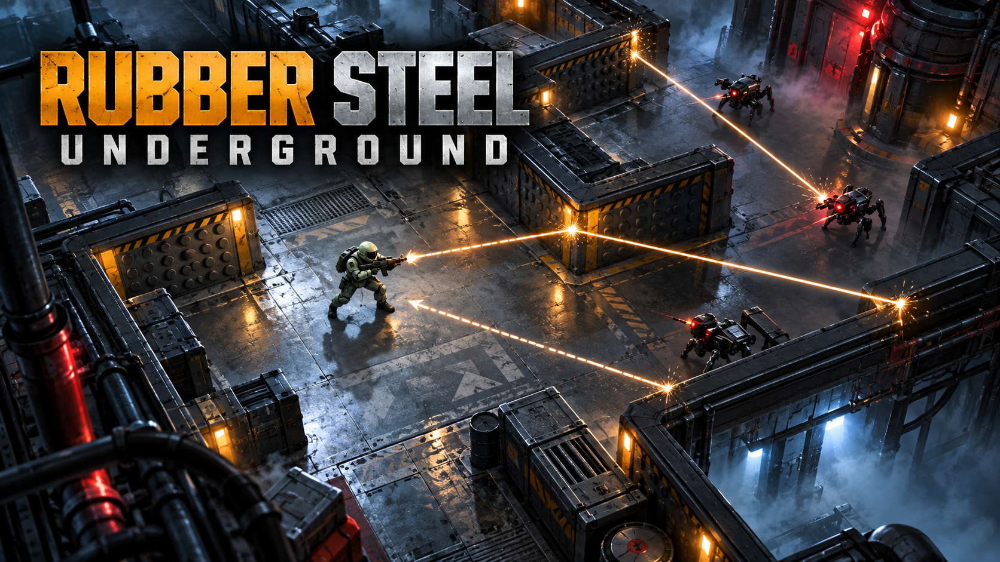

# RUBBER STEEL UNDERGROUND

**跳ね返る弾が、最後まで消えない。**

RUBBER STEEL UNDERGROUND（RSU）は、跳弾の軌道を読みながら敵を倒し、地下施設を攻略する見下ろし型ローグライト・アクションシューティングです。自分の弾は敵に当たるまで消えず、壁で何度でも反射します。外した一発は部屋に残り続け、やがて自分へ戻ってくるかもしれません。撃つことと避けること、その両方が攻略の鍵です。

ブラウザー版とWindows版を収録しています。ゲーム本編は **5エリア・50ステージ・各10フロア、全500フロア**。1回の被弾でランが終わる緊張感の中、武器と一時能力を選びながら最深部を目指します。



用途に合わせた縦長版と正方形版も用意しています：[縦長 2:3](images/rsu-key-visual-2026-10-13-portrait.png) / [正方形 1:1](images/rsu-key-visual-2026-10-13-square.png)。

## まず遊ぶ

### ブラウザーで遊ぶ

公開済みのゲームURLがある場合は、URLをブラウザーで開くだけで遊べます。ローカルで試す場合は、Node.js 22以降を用意し、プロジェクトフォルダーで次を実行してください。

```powershell
npm ci
npm run dev
```

表示されたローカルURLをブラウザーで開きます。ゲームの進行状況と設定はブラウザーの`localStorage`に保存されます。保存データはブラウザープロファイルや公開URLごとに分かれ、別の環境へ自動同期されません。

### Windows版で遊ぶ

`release/RUBBER_STEEL_UNDERGROUND-1.0.0-win.zip`を展開し、`RUBBER_STEEL_UNDERGROUND.exe`を起動します。プレイヤー側でNode.jsを準備する必要はありません。Windows実行ファイルのコード署名は設定していません。

## ゲームの進め方

1. **フロアへ進入** — 敵、壁、部屋の形を見て移動ルートを考えます。
2. **敵を全滅させる** — 自弾の跳ね返りを利用して攻撃します。射撃位置と退路を確保し、戻ってくる弾にも注意します。
3. **出口へ向かう** — 敵を倒しても自弾は消えません。出口へ移動する間も、残った弾を避ける必要があります。
4. **次のフロアへ** — 10フロアを突破するとステージクリア。次のステージが解禁されます。

プレイヤーは**HP 1**で、敵弾や自分の弾に当たるとそのフロアで倒れます。死亡すると現在のランで選んだ一時能力を失い、そのフロアから再挑戦します。クリア済みステージや解禁したキャラクターなどの進行状況は保存されます。

2・4・6・8フロアを脱出すると、**18種類の一時能力から提示される3候補のうち1つ**を選べます。攻撃を補助する能力、移動や射撃を強化する能力、反射弾を扱いやすくする能力などがあり、選択はそのランの攻略方針を変えます。能力はラン限定で、死亡すると失われます。

## 500フロアと5つのエリア

| ステージ | エリア | 進行の目安 |
| --- | --- | --- |
| 1–10 | ENTRY SECTOR | 基本操作を学び、最初のエリアボスへ。 |
| 11–20 | INDUSTRIAL SECTOR | 工業設備の区画。ステージ20クリアでFIRE解禁。 |
| 21–30 | EXPERIMENT SECTOR | 実験区画。ステージ30クリアでICE解禁。 |
| 31–40 | CONTAINMENT FAILURE | 封鎖が崩れた区画。ステージ40クリアでTHUNDER解禁。 |
| 41–50 | RUBBER STEEL CORE | 最深部。ステージ50の最終ボスを目指します。 |

各ステージは10フロアで構成され、10フロア目にボスと取り巻きが登場します。各エリアの最終ステージ（10・20・30・40・50）ではエリアボスが待ち受けます。ボスはエリアごとの耐久力・移動・攻撃間隔を持ち、弾を1〜3発の扇状に撃ちます。通常のエリートボスは攻撃を予告してから2発を放ちます。

エリアが進むにつれて、ステージ全体の敵数は増えていきます。

| ステージ | 1ステージあたりの敵数（ボスを含む） |
| --- | ---: |
| 1 | 59 |
| 2–10 | 各63 |
| 11–20 | 各100 |
| 21–30 | 各145 |
| 31–40 | 各198 |
| 41–50 | 各258 |

初期配置は最大12体です。残りの敵は、場に残る敵が4体以下になってから最大6体ずつ増援として参加します。増援後の同時数は最大10体なので、初期配置を含むライブ敵数は12体を超えません。出現場所は約2秒前に予告され、プレイヤーや既存の敵、稼働中のギミックに近い地点は安全な距離が取れるまで延期されます。生成フロアの最初の3体組は、入口から2体以上を見通せる範囲へ優先配置します。複数体を一度に攻撃する機会と、跳弾が増える危険の両方を生みます。

敵には近接型、射撃型、装甲型、ボスがいます。装甲型はHP 2で、最初の弾を反射します。部屋によっては予告付きで動く壁や崩落床が現れるため、敵だけでなく移動経路と安全な立ち位置も確認してください。

## 武器

| 武器 | 特徴 | 向いている場面 |
| --- | --- | --- |
| **STANDARD** | 弾速の速い単発射撃。 | 狙った敵を正確に攻撃したいとき。未破壊の装甲に初弾を当てると反射するため、装甲を安全に剥がす選択肢にもなります。 |
| **TRIPLE SHOT** | 3方向へ同時発射。3発とも敵に当たるまで残ります。 | 敵がまとまっているとき。広く攻撃できますが、外した弾が増えるほど退路も危険になります。 |
| **HEAVY SHOT** | 弾速は遅め、ダメージ3、弾半径8。 | ボスや装甲解除後の装甲敵に。未破壊の装甲への最初の命中は反射されます。 |

敵の装甲は初回の命中を反射し、破壊後にダメージを受けるようになります。装甲敵はHP 2を持ちます。武器の威力だけでなく、撃った弾がどこで反射し、どこを通って戻るかを考えて使い分けます。

## キャラクター

| キャラクター | 解禁条件 | 特性 |
| --- | --- | --- |
| **STANDARD** | 最初から使用可能 | 基準となる機動力。追加の命中効果はありません。 |
| **FIRE** | ステージ10をクリア | 命中時に小範囲へ火炎ダメージ。STANDARDより移動がやや遅め。 |
| **ICE** | ステージ20をクリア | 命中地点付近の敵を短時間減速。 |
| **THUNDER** | ステージ30をクリア | 命中時、近くの別の敵へ一度だけ電撃が連鎖。移動は遅め。 |

どのキャラクターもHPは1です。キャラクターの特性で攻撃を補いながら、被弾しない立ち回りを続けます。

## 操作方法

| 操作 | 入力 |
| --- | --- |
| 移動 | `WASD` または矢印キー |
| 照準 | マウス移動 |
| 射撃 | マウス左クリック |
| 武器切替 | `1` STANDARD / `2` TRIPLE SHOT / `3` HEAVY SHOT |
| 一時停止 | `Esc` |
| 死亡したフロアを再挑戦 | `R` |
| 全画面表示 | 画面右上の`FULL SCREEN`ボタン |

タッチ端末では、画面左側をドラッグして移動し、右側をドラッグして照準・射撃します。操作スペースを確保しやすい**横向き**を推奨します。

## ビジュアルとサウンド

地下施設の床・照明・アクセントカラーはエリアに応じて変わります。小さな画面でも兵士・敵・自弾・敵弾を見分けられるよう、輪郭と色、弾道のトレーサー、発射反動、被弾フラッシュで戦闘状態を表現します。HUD、フロア名、増援・ギミックの警告も施設の工業的な意匠に統一しています。効果音はプログラムで生成し、通常ステージでは`RSU-main.mp3`、10の倍数のボスステージでは`RSU-boss.mp3`を再生します。SETTINGSの`MASTER`と`BGM`で音量を調整できます。

## Vercelで公開する

ブラウザー版はVercelで公開しています：[RUBBER STEEL UNDERGROUNDを遊ぶ](https://rubber-steel-underground.vercel.app/)。このゲームはサーバー機能を必要としない静的なViteアプリです。GitHubとVercelのプロジェクトを連携すると、対象ブランチへのpushで再デプロイされます。設定は[`vercel.json`](vercel.json)にあります。

| 項目 | 設定 |
| --- | --- |
| Framework Preset | Vite |
| Root Directory | プロジェクトルート |
| Install Command | `npm ci` |
| Build Command | `npm run build` |
| Output Directory | `dist` |
| 環境変数 | 不要 |

公開後の進行状況は、アクセスしたURLとブラウザープロファイルに紐づくローカル保存です。別のブラウザーや端末へ自動同期されません。

## 開発・検証

Node.js 22以降を使用してください。

```powershell
npm ci
npm run dev
npm test
npm run verify:content
npm run build
```

主な検証コマンド:

| コマンド | 内容 |
| --- | --- |
| `npm test` | 跳弾、装甲反射、武器、能力、キャラクター、ギミック、進行、セーブ移行などの単体テスト。 |
| `npm run verify:content` | 全500フロアの生成、敵・出口への到達性、ギミック配置、敵数、生成フォールバックを検証。`-- --profile`でエリア別の構成も集計。 |
| `npm run test:playthrough -- 50 thunder adaptive` | 固定シードの自動操縦で指定ステージを計測。ステージ、キャラクター、武器方針、開始フロアを引数で指定できます。`--single-floor`で指定した階のみ計測できます。 |
| `npm run test:browser` | ローカルのViteサーバーを自動起動し、ブラウザー表示・操作を検証。`RSU_TEST_URL`を指定するとそのURLを検証。 |
| `npm run test:mobile` | ローカルサーバーまたは`RSU_TEST_URL`でスマートフォン幅のタッチ操作と表示領域を検証。 |
| `npm run test:desktop` | Windows用パッケージのEXE起動を検証。 |
| `npm run test:debug` | ローカルのViteサーバーを自動起動し、デバッグ用ステージ移動と高負荷時のFPS・描画時間・弾数を検証。`RSU_TEST_URL`を指定するとそのビルドを検証。 |

Windows版ZIPは`npm run package:win`で`release/`へ生成できます。PlaywrightのテストはMicrosoft Edgeを使用します。

自動プレイ計測の詳しい結果は[`VALIDATION.md`](VALIDATION.md)を参照してください。自動操縦はステージや武器の比較に使う検証モデルであり、人間による遊びやすさ・公平性の評価は未完了です。

## プロジェクト構成

- `src/data.ts` — ゲーム定数、初期フロア、キャラクター、武器、一時能力。
- `src/world.ts` — 5エリアと50ステージ、シード付きフロア生成、敵配置と到達性検証。
- `src/engine.ts` — 固定120Hzのゲーム進行、敵AI、弾・装甲・増援・ギミック・ステージ進行。
- `src/save.ts` — ブラウザー保存、旧セーブの移行、ステージとキャラクターの解禁。
- `src/main.ts` — 入力、メニュー、設定、Web Audio、Canvas描画との接続。
- `src/visuals/` — エリア、兵士、弾道、反射、発光、能力アイコンの描画。
- `electron/main.cjs` — Windowsデスクトップ版。
- `tests/`、`scripts/` — ルール・コンテンツ・ブラウザー・モバイル・デスクトップ検証。
- `images/` — ゲームのキービジュアルと生成プロンプト。

フロアは部屋テンプレート、敵構成、可動壁・崩落床を組み合わせて決定的に生成し、敵・出口への経路やギミックの安全性を検査します。自弾は時間や反射回数では消えず、敵への命中またはフロア移動時に消去されます。

ブラウザーでURL末尾に`?debug=1`を付けると、DEBUG MODEが開きます（例：`https://rubber-steel-underground.vercel.app/?debug=1`）。ステージ・フロア・キャラクターを指定して開始でき、無敵、ヒットボックス、敵・増援数、武器別の射撃・撃破・跳弾数、弾数、シード、フォールバック状態、描画時間も確認できます。デバッグプレイは進行、死亡数、クリアタイムに記録されず、ステージやキャラクターの解放状態も変わりません。通常版はクエリを外して開いてください。

## 配布前に確認すること

図形・キャラクター・効果音はプログラムで生成しています。BGMはプロジェクトの`src/assets/audio/`に収録した提供音源です。作者名、連絡先、実況・二次創作・転載の方針、免責文はまだ確定していません。公開・配布前に[`readme_ja.txt`](readme_ja.txt)のTODOを記入してください。
